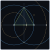

GEOMETOR • elementarium
=======================

**Visit the Online Archive:** https://geometor.github.io/elementarium/

**Elementarium • Zero-context optical bootstrap & 100,000-year geometric archive**

Mission
-------

``geometor/elementarium`` is part of the interconnected `GEOMETOR <https://geometor.com>`_ semantic digital archive. It designs, prototypes, and formalizes a monolithic, unpowered optical archive in fused silica (:math:`\text{SiO}_2`) engineered for a 100,000-year deep-time preservation horizon. By encoding foundational constructive geometry (*Euclid I.1* Vesica Piscis, Rational Trigonometry, and invariant proportion) as a zero-context primer before natural language, it liberates human knowledge from electrical power grids and fragile digital infrastructure into permanent optical geometry.

Capabilities & Interactive Docs
-------------------------------

- **`Elementarium <https://geometor.github.io/elementarium/>`_** — Comprehensive technical specification and deep-time optical archive architecture.
- **`Four-Tier Optical Stack <https://geometor.github.io/elementarium/architecture/>`_** — Concentric optical escalation from raw pinhole shadow projection (T0) to interferometric cold-boot machine layers (T3).
- **`Zero-Context Geometric Primer <https://geometor.github.io/elementarium/primer/>`_** — Formal deductive primer establishing logic, equivalence, arithmetic, and proof from constructive geometry.
- **`Mark I Desktop Prototype <https://geometor.github.io/elementarium/prototype/>`_** — Benchtop optical assembly and fused-silica reticle fabrication standards.
- **`Dual-Observer Recovery Protocols <https://geometor.github.io/elementarium/recovery/>`_** — Systematic decoding procedures for biological observers and autonomous machine vision.

Repository Contents
-------------------

- ``docsrc/`` — RST technical specifications, architectural diagrams, and plate manifests compiled by `PHOTON publish <https://github.com/photon-platform/publish>`_.
- ``src/geometor/elementarium/`` — CLI tools, optical tier specifications, plate generators, and SVG mask exporters.

Local Build & Verification
--------------------------

.. code-block:: bash

   publish build
   uv run --no-sync pytest

Part of the GEOMETOR Knowledge Archive
--------------------------------------

Explore all **74 Book Codices** and **11 Mathematical Catalogs** at https://geometor.com/books/.
